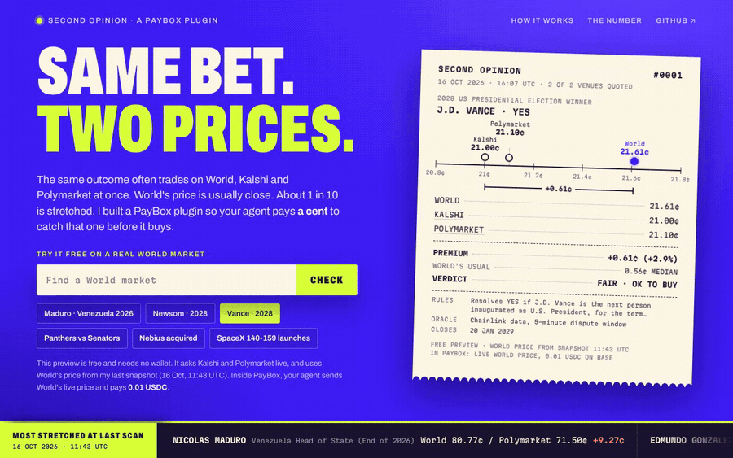
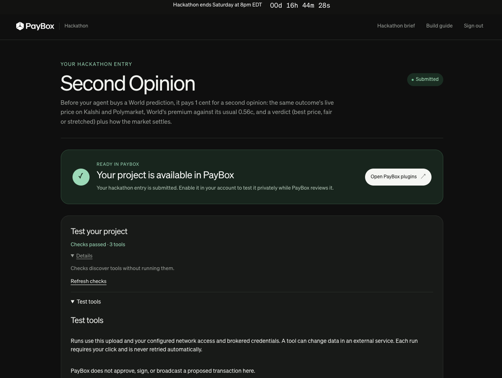

<p align="center"></p>

<h1 align="center">Second Opinion</h1>

<p align="center"><strong>Before your agent buys a prediction, it pays a cent for a second opinion.</strong><br>
A PayBox plugin for World markets, built for MoonPay Hackathons, Chapter 1 (Predictions).</p>

<p align="center"><a href="https://second-opinion-paybox.vercel.app">Try it on a real World market</a> · <a href="#how-your-agent-uses-it">Use it in PayBox</a> · <a href="#proof-it-runs-end-to-end">Proof it runs</a></p>

---

The same outcome often trades on World, Kalshi and Polymarket at once. On 16 October I matched **793 live World outcomes** to the same outcome on the other two. On half of them World was within **0.56c** of the cheapest other venue, and on 90% within 1.56c. But **49** were 2c or more over on the quoted price, and on those a buyer paid a median of about $20 more per $100 than on the cheaper venue. After Kalshi's and Polymarket's taker fees the picture is kinder to World (it is the cheapest on 408 of the 793), but **28** were still 2c or more over.

An agent buying on your behalf can't tell a normal price from one of those. So I built a PayBox plugin that lets it ask. It costs 0.01 USDC on Base, paid through PayBox with your approval, and it comes back with a receipt:

- World's price, Kalshi's and Polymarket's for the same outcome, side by side
- World's premium, measured against World's own usual premium
- the same comparison after Kalshi's and Polymarket's taker fees (World doesn't add a separate fee)
- a verdict the agent can act on: **BEST PRICE**, **FAIR PRICE**, or **STRETCHED** (worth waiting, or only buying at a given price or less). BEST PRICE means World is at or below the cheapest other venue. If Kalshi and Polymarket disagree by more than 3c, it says **CHECK RULES** instead, because that usually means the markets aren't quite the same question
- how the market settles, from World's own market data: the rules, the data source (Chainlink), the dispute window, the close date

Most checks come back FAIR PRICE, because on most outcomes World is priced in line with the other two. You pay the cent to catch the ones where it isn't.

## Try it

Open **[second-opinion-paybox.vercel.app](https://second-opinion-paybox.vercel.app)**. No wallet, no login. Pick a market or search for one, and the check runs live against Kalshi and Polymarket. The free page uses World's price from my last snapshot and says so on the receipt. Inside PayBox, your agent passes World's live price and pays the cent.

## Install it in PayBox

Second Opinion is submitted to the PayBox marketplace and pending review. Once it's listed:

1. Open [app.paybox.sh/plugins](https://app.paybox.sh/plugins), find **Second Opinion** under Unofficial plugins and choose **Enable**.
2. Make sure the **World** plugin is enabled too, and that your agent (Claude, ChatGPT or Grok) is connected to PayBox.
3. Fund your EVM wallet with a little USDC on Base. Each check costs 0.01.

## How your agent uses it

Second Opinion sits next to PayBox's own World plugin.

1. Your agent finds the outcome with the **World** plugin (`world_search`, then `world_get_markets`), which gives it the market ticker and the live YES ask.
2. It calls **Second Opinion's** `second_opinion` tool with that ticker and price.
3. PayBox shows a **0.01 USDC** payment on Base. You approve it with your passkey.
4. The receipt comes back in the chat. The agent buys, waits, or sets a lower price.

Try this in Claude with the PayBox connector on:

> Get me a Second Opinion on Newsom YES for 2028 on World before I buy. It's a 1-cent data fee, so open the PayBox signing window straight away.

The plugin has three tools:

| Tool | Cost | What it does |
|---|---|---|
| `second_opinion` | 0.01 USDC | The full check for one World market. Returns an x402 payment proposal; PayBox pays it and returns the receipt. |
| `stretched_now` | free | The most stretched World prices at the last scan, so an agent knows where to look first. |
| `covered_markets` | free | Search the World markets the plugin has matched. |

## Proof it runs end to end

Four real paid checks from my own PayBox account. In the last two, the agent took World's live price from PayBox's World plugin before calling Second Opinion:

| When (UTC) | Market and verdict | Base transaction |
|---|---|---|
| 16 Oct 15:58 | Newsom YES 2028: STRETCHED, World 10.55c vs Polymarket 9.00c, buy at 9.6c or less | [`0x970adb03...8b8a`](https://basescan.org/tx/0x970adb03a9dc0d1d82a8ac0756859547a96fe6d46348d807d7d0b913e3ed8b8a) |
| 16 Oct 16:04 | Newsom YES 2028: STRETCHED, same numbers | [`0x872e1d37...4c3b`](https://basescan.org/tx/0x872e1d3704220b05194f971c3b4902867c8fa31211dba69b9029db9efb754c3b) |
| 16 Oct 16:24 | Newsom YES 2028: STRETCHED, World's live ask 10.55c from the World plugin vs Kalshi 10.00c and Polymarket 9.00c | [`0xf46b8dc6...a6a7`](https://basescan.org/tx/0xf46b8dc6db9cf368d478e1fca67ef41eb7b859d3169e06b4d980f4498020a6a7) |
| 17 Oct 07:17 | Karen Bass YES, LA mayor: FAIR PRICE, World's live ask 47.75c vs 47c on Kalshi and Polymarket. After their taker fees, World is the cheapest | [`0xfe217631...3300`](https://basescan.org/tx/0xfe21763115c16c17f3c276e120affb8d9dbb875903b86f217e79d03479023300) |

Each one is a 10,000-unit (0.01) USDC transfer on Base from my PayBox wallet (`0x011E...Ff29`) to the service's receiving address (`0x7BcA...c2c77`), settled through x402. The x402 facilitator submits it in a Multicall3 batch, so on Basescan the transaction's sender is the facilitator; the USDC transfer line shows my wallet paying.

The plugin is submitted in PayBox's developer portal, with its checks passed and all 3 tools found:

<p align="center"></p>

## The number, and how I got it

On 16 October at 11:43 UTC I pulled every active World market through PayBox's World plugin: 288 events and 928 markets. I matched each one to Kalshi and Polymarket only where the question, the outcome and the resolution period were clearly the same. Anything unsure was left out, including markets with different dates, different participants or different rules. That gave 816 outcomes priced on World and at least one other venue. I then left out 23 where Kalshi and Polymarket disagreed with each other by more than 3c, since that usually means the rules differ, leaving **793**.

| Measure | Value |
|---|---|
| Matched outcomes used | 793 |
| Median World premium over the cheapest other venue | 0.56c |
| 90th percentile | 1.56c |
| Outcomes 2c or more over | 49 |

Prices are YES asks before venue fees, and these numbers set the verdicts. I kept the verdict on the quoted price on purpose: it asks whether World's price is in line with where the market is trading, and the after-fees line says what the same share would actually cost elsewhere. An agent gets both. FAIR means the premium sits inside World's normal range. STRETCHED means it is above about the 90th percentile (1.6c), or 1c or more and over 15% on top of the other venue's price.

Kalshi and Polymarket also charge buyers a taker fee: Kalshi 0.07 × p × (1 − p) per share, Polymarket its category rate (0 for geopolitics, 0.04 for politics, up to 0.07 for crypto) × p × (1 − p). World doesn't add a separate trading fee; its cost is in the quote. With those fees added, World is the cheapest venue on **408 of the 793** outcomes, the median premium is **−0.05c**, and **28** are still 2c or more over. Since 17 October every receipt shows this after-fees view next to the verdict. (I used World's category for Polymarket's fee rate and left out Kalshi's rounding up to the cent per order.)

| After the other venues' taker fees | Value |
|---|---|
| World cheapest | 408 of 793 |
| Median World premium | −0.05c |
| Outcomes 2c or more over | 28 |

How the verdicts fall across all 816 matched outcomes at the snapshot:

| Verdict | On the quoted price | After the other venues' fees |
|---|---|---|
| BEST PRICE | 2 | 408 |
| FAIR PRICE | 620 | 258 |
| STRETCHED | 171 | 127 |
| CHECK RULES | 23 | 23 |

STRETCHED catches more than the 49 that are 2c or more over, because on cheap shares a smaller gap can still be over 15% of the price.

## How it works

```
Agent (Claude + PayBox) ──> World plugin: ticker + live YES ask
        │
        └──> Second Opinion plugin (PayBox-hosted sandbox)
                 returns an x402 proposal: GET /api/check?ticker=...&world_ask=...
        │
PayBox: you approve 0.01 USDC on Base ──> /api/check (Vercel)
                                              ├─ verify payment (x402 facilitator)
                                              ├─ live quotes: Kalshi API, Polymarket API
                                              ├─ verdict against World's measured premium
                                              └─ settle payment, return the receipt
```

- `plugin/`: the PayBox plugin, a standard MCP server built from PayBox's starter (TypeScript, bundled to one `plugin.mjs`). It passes PayBox's local conformance checks and hosted checks.
- `service/`: the paid endpoint, the free preview and the judge page, on Vercel. x402 v1 `exact` on Base, settled through a public facilitator.
- `indexer/`: the matching scripts and the index build (`build_index.py`) that maps each World market to its Kalshi and Polymarket twin.

## Limits

- World prices come from PayBox's World plugin. Inside PayBox they're live. On the free page they come from my last snapshot, and the receipt shows its time.
- The match index is a snapshot too. New World markets need a rebuild before they're covered.
- If the PayBox approval panel isn't showing, the tool's instructions have the agent call PayBox's `reopen_signing_window` straight away.
- The after-fees view uses Kalshi's and Polymarket's published taker-fee formulas as of 17 October. Venue fees change, and the verdict itself still compares YES asks.
- This is a price check, not financial advice.

## Built with

PayBox (plugin runtime, World plugin, x402 payments) · x402 on Base · Kalshi and Polymarket public APIs · Vercel.

I built this with AI coding agents during the hackathon window. I chose the idea, approved the design, tested the payment flow with my own wallet, and recorded the demo. The only work done before the window opened at 13:00 BST on 16 October is that morning's research scan, which matched World markets to Kalshi and Polymarket. Its scripts are in `indexer/`, and the numbers above come from it.

Robert Moore · [github.com/iamrobertmoore](https://github.com/iamrobertmoore)
